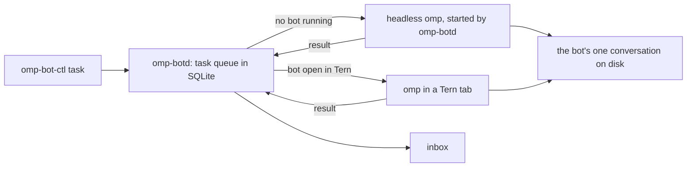

omp-bot turns an omp session in Tern into a named, animated bot you chat with, pet and run alongside other bots. Each bot keeps one conversation for good, and takes tasks in the background even when Tern is closed.

## Run

Needs Tern, omp, bun, jq and flock on `PATH` (`OMP_BIN` picks another omp; a bot runs on your omp config's default model unless `OMP_BOT_MODEL` names another).

- `bin/omp-botd` is the supervisor that queues tasks and runs bots. finix runs it as the `omp-botd` service.
- `bin/omp-bot-ctl task BOT TEXT [--key KEY] [--origin ORIGIN]` queues a task. `inbox` lists finished and failed tasks you haven't acknowledged, `ack ID` acknowledges one, `tasks` lists recent ones and `status` shows which bots are awake.
- In Tern, the palette's **Bots: Open all** opens a tab for every bot not yet open in the current session, each with an orb in the rail. **Bots: Open bot** opens or focuses one, or names a new one and adds it to the roster. **Bots: Remove bot** closes a bot's tab, fails its queued tasks, takes it off the roster and moves its conversation to `archive/`; `bin/omp-bot-remove NAME` does the same from a shell. Your own omp-chat styling stays; the flat chat look is only in the demo window.
- `bin/omp-bot NAME` opens the bot `NAME` in any terminal. `bin/omp-bot-demo` opens a separate Tern window with only the bots; `--stop` closes it.
- `OMP_BOT_NO_TOOLS=1` starts bots with `--no-tools`, so they can only talk. Use it, with a throwaway `OMP_BOT_STATE`, whenever you try prompts: a separate state folder keeps a bot's memory apart but not its access to this machine.
- Bots hide their tool activity by default (`display.hideToolActivity` in `omp/demo.yml`, the overlay every bot runs with), so a tab shows its replies, the orb and one status word. Ctrl+Shift+O, or `/settings`, shows the tool cards for the session.
- `~/.config/omp-bot/env`, when present, is read as shell before a bot starts; finix sets `OMP_BIN` there to omp outside omp-box.

The roster is `bots.json` in the state folder below, copied from this repo's `bots.json` the first time anything runs. Add a bot by adding a line to it: `name`, a one-line `role`, a `tint` (red, orange, yellow, green, teal, blue, purple or pink), the `cwd` it starts in, and optionally a `persona` with extra instructions. Bots start without your own omp extensions; `"extensions": true` on a bot loads the ones your omp config lists, on top of the bot's own. `"model"` picks a bot's model; without it the bot uses `OMP_BOT_MODEL`, else your omp config's default.

## Watching Tern

The Tern plugin sends two things to the daemon as they happen: a command that exited non-zero, and an agent whose turn or program ended. Each carries its pane, the command line, the exit status and the directory. The daemon's gate matches each one against `policy.json` and appends the decision to `shadow.log`, one JSON line per event: the rule that matched, which bot it would go to, the mandate, and the brief that bot would receive. It queues nothing, so this stage only shows what the bot would have been woken for.

```json
{"rules": [
  {"name": "failed-command", "kind": "command_finished", "when": {"status": "nonzero", "cwd": "~/dev"}, "bot": "Dev", "mandate": "diagnose"},
  {"name": "agent-done", "kind": "agent_finished", "bot": "Dev", "mandate": "review"}
]}
```

Rules are tried in order and the first match wins; an event that matches none is logged with `"rule": null`. `when` is optional and holds `status` (`zero` or `nonzero`) and `cwd`, a prefix that `~` expands in. `omp-bot-ctl event JSON` feeds one event in by hand.

## How it works



- **One process per bot.** Every bot runs omp with `omp/core.ts`, which connects to `omp-botd` and holds `bots/NAME/lock`, so a bot never runs twice. Opening a bot in Tern while it works in the background waits for the current task, stops the background copy and opens the same conversation.
- **Memory.** A bot's conversation lives in `bots/NAME/sessions` and every start continues it. omp's normal compaction keeps it within the context window.
- **Delivery is at least once, not exactly once.** A task is retried, up to 3 attempts, when its bot crashes, the model request fails or `omp-botd` restarts mid-task. A crash after a bot acted but before it reported back repeats the task, so each task carries its ID and attempt number. A retry is told to check what the earlier attempt did, and bots tag anything they post outside the conversation with `omp-bot:ID`. A task stopped by hand in Tern fails without a retry. Queuing the same `--key` twice queues it once.
- **Bots asking bots.** A task queued with `--origin bot:NAME` answers that bot instead of your inbox: when it finishes or finally fails, its result is queued to `NAME` as a new task marked `reply:` with the answering bot's name, keyed so it arrives once. A reply never triggers another reply, so two bots can't loop.
- **Attention.** A bot that has nothing worth your attention replies exactly "Nothing to report.", and that result skips the inbox.
- **Prompt.** `omp/prompt.ts` adds each bot's identity to the end of omp's system prompt: its name, lane and persona as its voice, the roster, when to act, when to speak and how to ask for a decision, with live chat and background tasks told apart. A bot whose role is "Chief of staff" also triages: it does quick work itself, names the bot and the `omp-bot-ctl task` brief for the rest, and reads the inbox to tell you what waits on you. `omp/demo.yml` sets omp's personality to `none` so the persona sets the tone.
- **Removal.** Removing a bot stops its whole background process group mid-task and holds the bot's lock while it archives the conversation.
- **Sleep.** A background bot stops after 5 idle minutes (`OMP_BOT_IDLE_EXIT_MS`). A bot is never killed mid-task to sleep.
- **Look.** A bot tab opens with a header line (orb, name, role, a Stop button while it works); the orb and a one-line status sit under the latest reply. A bot is opaque: its tool work is hidden, so the transcript holds its replies and nothing else, and the status says "Working" without naming the tool, counting steps or timing the turn. Ctrl+Shift+O brings the tool cards back for the session, where each run folds into one "Worked 12s · 3 steps" line that opens on click. Each bot's eyes, rings, accessory, glow and tempo come from a hash of its name, so a new bot gets its own look without a roster field; its tint comes from the roster, or from the same hash when it has none. The orb glances around, blinks, perks up while you type, bounces when a reply lands, gets drowsy and then naps.

State lives in `${OMP_BOT_STATE:-${XDG_STATE_HOME:-~/.local/state}/omp-bot}`: `bots.json`, `tasks.db`, `bots/NAME/`, `logs/NAME.log` for background runs and `botd.sock`.

## Not built yet

- Per-bot optchat memory in place of omp's compaction.
- Triggers other than `omp-bot-ctl`: schedules and GitHub issues, with replies posted back where they came from.
- HAL9001 as chief of staff: reading other bots' memory and handing them tasks.
- The inbox inside Tern.
- Bots run omp directly on this machine, not in omp-box.

Initially drafted by Claude AI.
