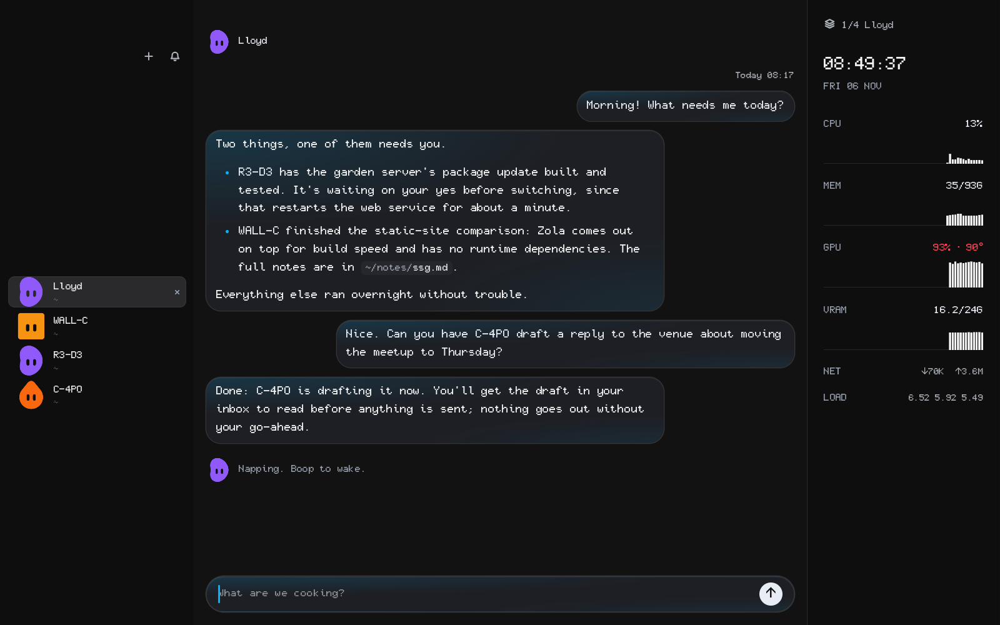
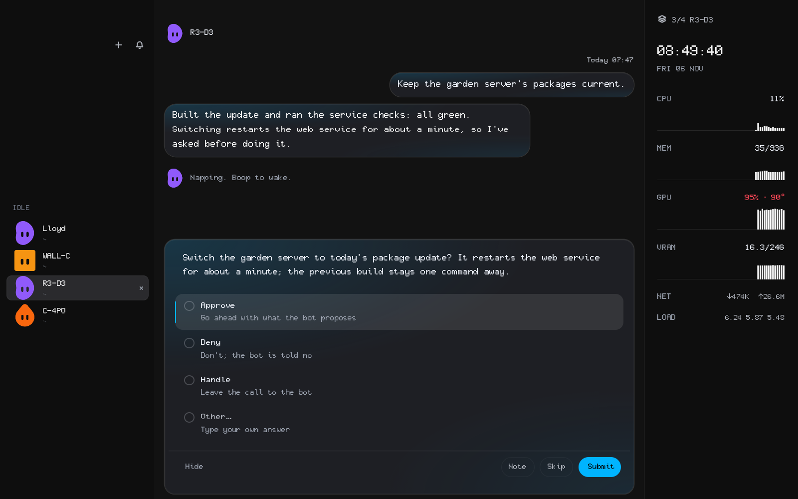
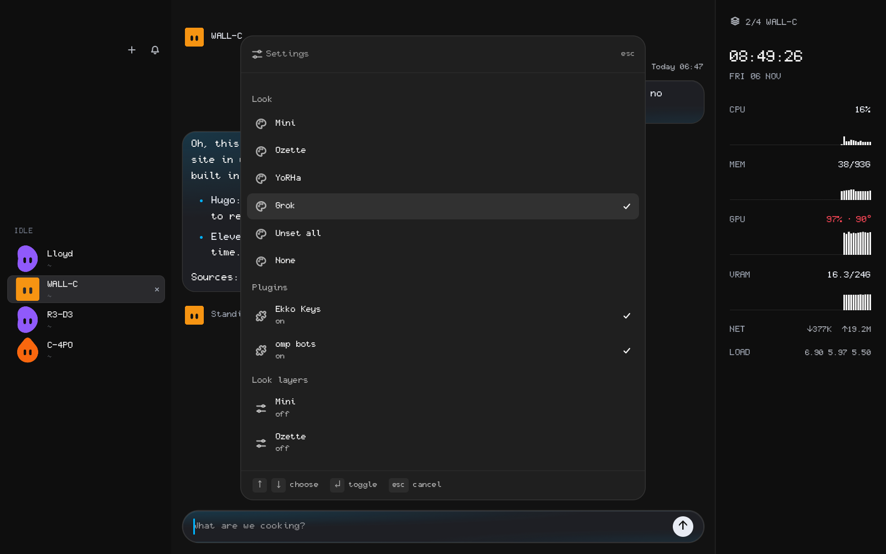

# omp-bot

omp-bot runs named omp agents ("bots") that each keep one conversation for good and take tasks in the background, in a Tern tab or with Tern closed.

A bot is an omp session with extensions from this repo loaded. Each bot is drawn as a Grok Bot-style avatar built from parts its name picks. A supervisor daemon queues tasks and starts bots when they have work. A job daemon, ompd, runs their shell commands and helpers outside the bot's process, so a restart or crash doesn't lose them.

*Lloyd's chat in Tern under the Grok look, with the bot roster on the left and Ekko's system rail on the right.*

*R3-D3 parked a task on a decision: Approve, Deny or Handle answers it from the bot's tab.*

*Ctrl+Alt+, opens the Settings menu; Look › Grok restyles the chat. All three show demo bots and conversations.*

## Run

| Command | Does |
| --- | --- |
| `bin/omp-botd` | Supervisor: task queue (SQLite), starts and stops background bots. finix runs it as the `omp-botd` service. |
| `bin/ompd serve [--wait]` | Job daemon. One copy per state folder; `--wait` waits for the lock instead of exiting. finix runs it as the `ompd` service. |
| `bin/omp-bot NAME` | Open a bot in any terminal. `--create TINT` adds it to the roster first. |
| `bin/omp-bot-ctl task BOT TEXT [--key K] [--origin O]` | Queue a task. The same key queues once; `--origin bot:NAME` sends the result to that bot. |
| `bin/omp-bot-ctl inbox` / `ack ID` | Decisions waiting on you, and unacknowledged results. |
| `bin/omp-bot-ctl approve\|deny\|handle ID [NOTE]` | Answer a decision (`handle` leaves it to the bot). |
| `bin/omp-bot-ctl tasks` / `status [--json]` | Recent tasks; which bots are up, and why any are down. |
| `bin/omp-bot-ctl restart BOT [--now]` | Restart a bot once idle; `--now` stops its turn and retries the task. |
| `bin/omp-bot-remove NAME [--purge]` | Take a bot off the roster and archive its conversation; `--purge` also deletes its persisted folders. |
| `bin/omp-bot-demo [--stop]` | Open a separate Tern window with only the bots. |
| `bin/ompd jobs\|show ID\|kill ID\|run [--task ID] [--monitor REGEX] ...` | Inspect or start jobs by hand. |
| `bin/ompd task add --title T [--key K] [--check CMD] [--ask Q] ...` / `tasks [--owner O] [--all] [--json]` | Tasks ompd owns. A task with a check command is done only when that command exits 0; `task add` prints its id and `task check\|ask\|answer\|note\|drop` work on one. The same owner and `--key` return the first task instead of adding another. |

In Tern, the `tern/` plugin adds **Bots: Open all**, **Bots: Open bot**, **Bots: Remove bot** and **Bots: Change avatar** to the palette, plus each bot's avatar in its tab, header, messages and Tern's own notification card under every look (`tern/avatars.css`), and the base style of the chat's own cards and working row (`tern/chat.css`).

To try prompts safely, set `OMP_BOT_NO_TOOLS=1` and a throwaway `OMP_BOT_STATE`. A separate state folder isolates memory, not access to the machine.

## Dependencies

omp, bun, jq and flock on `PATH`, and Tern for tabs. A boxed bot also needs bash, ssh, tar and finix's `omp-box`. Bot memory needs OptChat (from finix's `modules/dev/ai/omp/optchat`).

## Roster

`bots.json` in the state folder, copied from this repo's `bots.json` on first run. One object per bot:

| Field | Meaning |
| --- | --- |
| `name` | Letters, digits, space, `.`, `_`, `-`; up to 40 characters. |
| `tint` | red, orange, yellow, green, teal, blue, purple or pink. |
| `cwd` | Where the bot starts. `/move DIR` in the bot updates it. |
| `persona` | Extra instructions: the bot's voice and lane. |
| `model` | Model for this bot (else `OMP_BOT_MODEL`, else omp's default). |
| `extensions` | `true` loads the extensions your omp config lists. |
| `memory` | `optchat` (default) or `none` for omp's own compaction. |
| `persist` | Folders under `~` that must survive a reboot. |
| `box` | `true` runs the bot's omp inside omp-box. |
| `avatar` | Parts overriding the ones the name picks: `{"body": "ghost", "color": "#ff8800", "eyes": "happy", "accessory": "halo", "motion": "hop"}`. |
| | Part names are in `tern/avatars.json`; `body` may also name a drawn sprite in `tern/avatars/` (`lloyd`, `sol`, ...). **Bots: Change avatar** in Tern's palette writes this field, a pick part at a time, with the bot redrawn straight away; its **From name** row deletes it. |

A bot's own `bots/NAME/config.yml`, if present, is layered over `omp/demo.yml`. `bots/NAME/rules.md` holds standing rules given to the bot word for word; its `pin_rule` tool appends to it. `tools/NAME/bin/` goes on that bot's `PATH` only.

## Environment

`~/.config/omp-bot/env` is sourced before a bot starts, and `~/.config/omp-bot/box.env` after it for a boxed bot. finix writes both.

| Variable | Default | Meaning |
| --- | --- | --- |
| `OMP_BOT_STATE` | `$XDG_STATE_HOME/omp-bot` | State folder. |
| `OMP_BIN` | `omp` | omp to run. |
| `OMP_BOT_MODEL` | omp's default | Model for bots without `model`. |
| `OMP_BOT_OPTCHAT` | (required for memory) | OptChat directory. |
| `OMP_BOT_PERSIST` | none | Hook run as `HOOK mount PATH` / `HOOK purge PATH` for `persist` folders. |
| `OMP_BOT_EXTENSION`, `OMP_BOT_CWD_EXTENSION`, `OMP_BOT_SECRETS_EXTENSION`, `OMP_BOT_WORK_FOLD_EXTENSION`, `OMP_BOT_CHAT_LOOK_EXTENSION` | none | Extra omp extensions every bot loads. |
| `OMP_BOT_OMPD_EXTENSION` | `omp/ompd.ts` | Path bots load ompd's extension from (lets finix use one stable link). |
| `OMP_BOT_NO_TOOLS` | unset | `1` starts bots with `--no-tools`. |
| `OMP_BOT_IDLE_EXIT_MS` | 300000 | Idle time before a background bot sleeps. |
| `OMP_BOT_HEARTBEAT_MS` | 30000 | Task check-in interval; three misses retry the task. |
| `OMP_BOT_MAX_ATTEMPTS` | 3 | Attempts per task. |
| `OMP_BOT_MAX_STARTS` | 3 | Failed starts in a row before a bot is marked down. |
| `OMP_BOT_HEALTH_MS` | 60000 | How often a boxed bot's box is checked. |
| `OMP_BOT_HELD_MAX_MS` | 300000 | Longest backoff while a bot is open in a tab. |
| `OMP_BOT_DRAIN_MS` | 120000 | How long `omp-botd` lets busy bots finish on SIGTERM. |
| `OMP_BOT_MAX_HELPERS` | 8 | Helpers per bot at once (nesting stops at 2 deep). |
| `OMP_BOT_HELPER_MINUTES` | 60 | Longest a helper may run before ompd kills it. |
| `OMPD_SERVICE` | unset | `1`: a service runs ompd; bots wait for it instead of starting one. |
| `OMPD_FOREGROUND_S` | 300 | How long a command or helper is waited for before it continues in the background. |
| `OMPD_JOB_MEMORY` | `12G` | Memory cap per job cgroup, no swap. |
| `OMPD_MONITOR_MS` | 60000 | Shortest gap between a monitored job's wake batches. |
| `OMPD_LEAN_SLOTS` | half of RAM / cap | Concurrent Lean builds. |
| `OMPD_CGROUP` | ompd's parent cgroup | Where job cgroups go; without a writable one, jobs run uncapped. |

Boxed bots also read `OMP_BOT_BOX_SSH_CONFIG`, `OMP_BOT_BOX_STATUS`, `OMP_BOT_BOX_EXT` and `OMP_BOT_BOX_PATH` from `box.env`; see `bin/omp-bot-box`.

## How it works

- **One process per bot.** `bots/NAME/lock` keeps a bot from running twice. Opening a bot in Tern waits for its background copy to finish the current task, then takes over the same conversation.
- **Delivery is at least once.** A task is retried, up to 3 attempts, if its bot crashes, the model call fails, or check-ins stop. Each task carries its ID; bots tag anything they post elsewhere with `omp-bot:ID` so a retry can see what was already done.
- **Decisions.** A bot asks with `ask_decision`; the task waits in `inbox` and as a card in the bot's tab until you answer.
- **Kept answers.** A question the bot asked with `ask` stays in the chat once you answer it: a read-only card with the question and only what you picked, custom text or note, also after a restart.
- **Working row.** While a turn runs, the bot's avatar plays its motion under the transcript beside what it is doing ("Running a few commands", "Checking with helpers", "Needs your input"), and its tab avatar moves while Tern marks the tab working. After the turn the row stays only while background jobs or helpers run ("Waiting on 1 helper and 2 jobs") or the turn failed; otherwise it goes away.
- **Memory.** The model never gets the whole transcript. It gets the pinned rules, an OptChat summary tree of the conversation, and the latest turns raw. `zoom`, `date` and `recent` read any part back, also for another bot's memory, read-only.
- **Bots asking bots.** A task with `--origin bot:NAME` sends its result back to that bot as a `reply:` task. Replies never trigger replies.
- **Quiet results.** A bot that has nothing for you replies "Nothing to report.", which skips the inbox.
- **Durability.** Every bash command runs as an ompd job with its own log under `jobs/ID/`, with `pipefail` on. A command cut off by a crash is reported as outcome unknown, not rerun, unless marked rerunnable. `wait` returns the first of the session's jobs to end; a job the session killed reports at its next turn instead of waking it. `monitor: true` with an optional `filter` regex makes a running job wake the session with each new batch of matching lines, at most once a minute, dropping repeats, so a CI watch or a training-loss alert costs no model calls and keeps working across restarts. Turns resume after a restart with omp's `--restore`.
- **Helpers.** `omp/helpers.ts` replaces omp's task tool. Each helper is a headless omp session run as an ompd job; it reports back to its parent and survives the parent's restart. Results wait for the parent's next turn unless their first line is `[wake]` or they failed.
- **Barge-in.** A message you type while a bot is writing its reply lands at once instead of after the reply: `omp/barge-in.ts` queues it as a steer and aborts the run, which restarts the same turn with your message in it, and the aborted reply stays in the transcript. It never cuts a tool call in flight: omp's own steer handling takes the message there, and a blocking tool hands its work back as soon as a message is queued — `bash` and `wait` on an ompd job, `task` on its helpers — so the job or helpers keep running and their results arrive later; finix's `eval.autoBackground` does the same for a long cell.
- **Code mode.** `omp/code-mode.ts` gives bots persistent cells, bash by default: the code runs as a script with each enabled tool as an executable on `PATH` (`edit`, `lsp`, `web-fetch`, ...; `omp-read` where the shell has its own) that calls back through the same Python bridge, and `NAME --help` is generated from the tool's schema. A `language: "py"` cell calls any enabled tool as `await tool.NAME({...})` and keeps Python state. Both go through omp's normal approval hooks and tool limits. A cell a steer backgrounds keeps running in its own temp folder, which is cleaned up when it ends.
- **Git guard.** `git/git` sits first on bots' `PATH` and blocks push, rebase, `commit --amend`, filter-repo and filter-branch during a background task unless you approved that task. The bot exports the task's ID as `OMP_BOT_TASK`, so commands, scripts and helpers it starts are judged by that task's answer alone. A live message that asks you to push, rebase or amend is approval for the turn it starts, so a task waiting on jobs never needs a decision card for it; the grant is dropped as that turn ends, and a new task starts with none. This stops accidents and self-approval, not a hostile process running as your user.
- **Restart.** A bot in a tab exits with code 76; finix's Agent Tabs plugin reopens it in the same tab.
- **Down bots.** A bot that fails to start `OMP_BOT_MAX_STARTS` times, or whose box is unreachable, is marked down. Its queued tasks go to the inbox with the reason, and `restart BOT` tries again.

Some behaviour is hardcoded for the bot named Lloyd: a trimmed tool list, `proc://` reads of ompd jobs, and helpers that inherit his `rules.md` and default to the `task` model role.

## Persistence

On a machine whose home resets at boot, `OMP_BOT_PERSIST` keeps a bot's `persist` folders. Stopping, crashing or removing a bot never deletes them; removal only stops mounting them from the next boot. Only `omp-bot-remove NAME --purge` deletes them, skipping any folder another bot still lists.

## Boxed bots

`"box": true` runs the bot's omp inside omp-box, finix's microVM, over ssh. Its tab, queue and memory summariser stay on the host. `bin/omp-bot-box` shares the bot's folder and `persist` folders into the box at the same paths. Secrets stay in `bots/NAME/secrets`, encrypted, and are decrypted only inside the box.

If the box goes away, the tab waits for it and resumes. Five quick cut-offs in a row close the tab instead.

## State

Everything lives in `$OMP_BOT_STATE`:

| Path | Holds |
| --- | --- |
| `bots.json` | Roster. |
| `tasks.db` | Task queue. |
| `bots/NAME/` | `sessions/`, `optchat/`, `rules.md`, `config.yml`, `helpers/`, `secrets/` (boxed). |
| `logs/` | Background bot logs, `NAME.optchat.log`, `ompd.log`. |
| `jobs/ID/` | ompd job record, command, log and report; deleted 7 days after delivery. |
| `archive/NAME-DATE/` | Removed bots' conversations and roster entries. |
| `botd.sock`, `ompd.sock` | Daemon sockets. |
