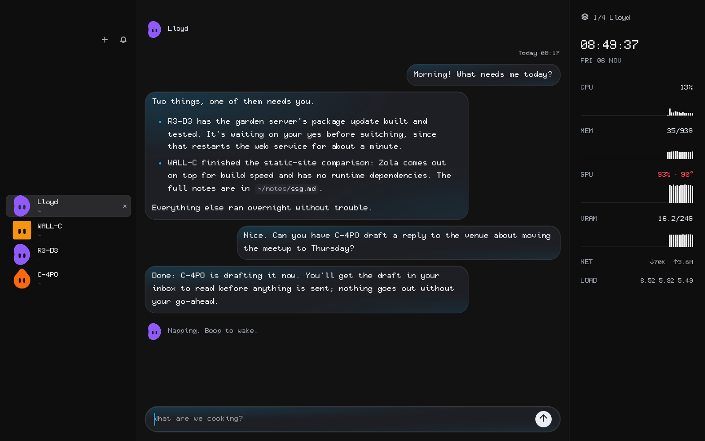
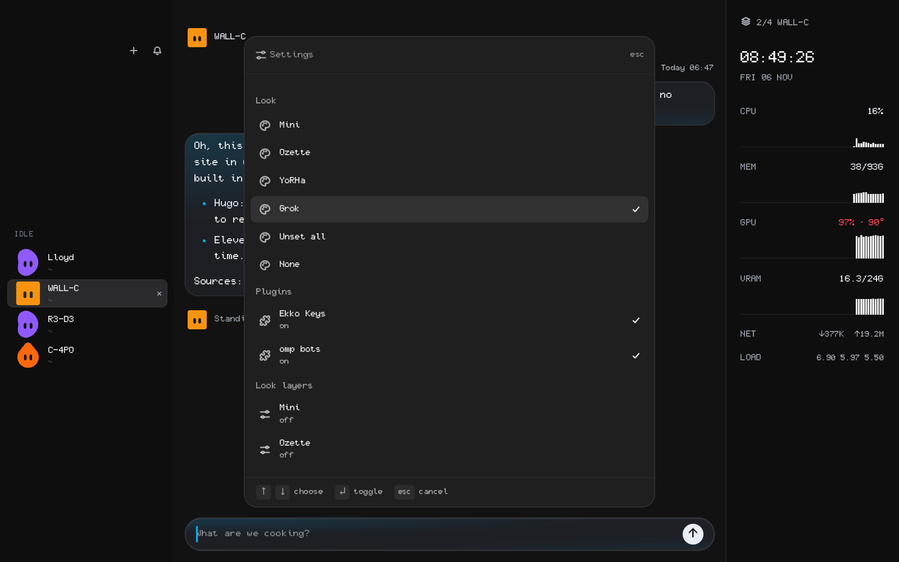

# omp-bot

omp-bot opens named omp sessions ("bots") in your Tern tabs, each drawn as a small pixel body with its own colour, persona, folder, model and OptChat memory.

A bot is an ordinary omp session with a few extensions from this repo loaded. It runs while its tab is open, keeps one conversation for good, and reads its memory as a summary tree rather than the whole transcript.

*Lloyd's chat in Tern under the Grok look, with the bot roster on the left and Ekko's system rail on the right.*

*Ctrl+Alt+, opens the Settings menu; Look › Grok restyles the chat. Both show demo bots and conversations.*

## Run

| Command | Does |
| --- | --- |
| `bin/omp-bot NAME [--create TINT] [omp args...]` | Open a bot in any terminal. `--create TINT` adds it to the roster first. |
| `bin/omp-bot-remove NAME [--purge]` | Take a bot off the roster and archive its conversation; `--purge` also deletes its persisted folders. |
| `bin/omp-bot-ctl restart BOT` | Restart a bot once its turn ends; its tab reopens the same conversation. |
| `bin/omp-bot-avatar NAME JSON` / `--name` | Write or clear a bot's `avatar` parts. |
| `bin/omp-bot-memory NAME` | Run that bot's OptChat summariser. |
| `bin/omp-bot-demo [--headless\\|--stop]` | Open a separate Tern window with only the bots. |
| `bin/omp-bot-health` | Report whether a boxed bot's box answers over ssh. |
| `bin/omp-bot-box` | Run a boxed bot's omp inside omp-box; `bin/omp-bot` calls it. |

In Tern, the `tern/` plugin adds **Bots: Open all**, **Bots: Open bot**, **Bots: Remove bot** and **Bots: Change avatar** to the palette, plus each bot's avatar in its tab, header, messages and Tern's own notification card under every look (`tern/avatars.css`), and the base style of the chat's own cards and working row (`tern/chat.css`).

To try prompts safely, set `OMP_BOT_NO_TOOLS=1` and a throwaway `OMP_BOT_STATE`. A separate state folder isolates memory, not access to the machine.

## Dependencies

omp, jq and flock on `PATH`, and Tern for tabs. A boxed bot also needs bash, ssh, tar and finix's `omp-box`. Bot memory needs OptChat (from finix's `modules/dev/ai/omp/optchat`).

## Roster

`bots.json` in the state folder, copied from this repo's `bots.json` on first run. One object per bot:

| Field | Meaning |
| --- | --- |
| `name` | Letters, digits, space, `.`, `_`, `-`; up to 40 characters. |
| `tint` | red, orange, yellow, green, teal, blue, purple or pink. |
| `cwd` | Where the bot starts. `/move DIR` in the bot updates it. |
| `persona` | Extra instructions: the bot's voice and lane. |
| `model` | Model for this bot (else `OMP_BOT_MODEL`, else omp's default). |
| `extensions` | `true` loads the extensions your omp config lists. |
| `memory` | `optchat` (default) or `none` for omp's own compaction. |
| `persist` | Folders under `~` that must survive a reboot. |
| `box` | `true` runs the bot's omp inside omp-box. |
| `secrets` | The shared secrets a boxed bot may read, by name. Without it a boxed bot gets none, so sharing a secret never quietly hands it to every bot. |
| `work` | `true` gives the bot an open-work list, `bots/NAME/work.txt`: one `todo` or `wait` line per unfinished ask, each ending `check: <command>` (exits 0 once done) or `check: manual <what>`; a wait on the user quotes the question asked. After each turn the checks run (`OMP_BOT_WORK_CHECK_SECONDS`, 60): a pass removes the line and logs command, exit and output to `bots/NAME/done.log`; a checked line deleted before passing comes back, and `drop <ask> (why)` drops one. The bot is sent todo lines, check results, uncovered or unquoted lines and day-old questions, until none are left, a nudged turn makes no tool call, or `OMP_BOT_WORK_NUDGES` (6) nudges in a row. |
| `avatar` | Body and colour overriding the ones the name picks: `{"body": "hex", "ink": "orchid"}`. |
| | Body and ink names are in `tern/avatars.json`. **Bots: Change avatar** in Tern's palette writes this field, a pick part at a time, with the bot redrawn straight away; its **From name** row deletes it. |

A bot's own `bots/NAME/config.yml`, if present, is layered over `omp/demo.yml`. `bots/NAME/rules.md` holds standing rules given to the bot word for word; its `pin_rule` tool appends to it. `tools/NAME/bin/` goes on that bot's `PATH` only.

## Environment

`~/.config/omp-bot/env` is sourced before a bot starts, and `~/.config/omp-bot/box.env` after it for a boxed bot. finix writes both.

| Variable | Default | Meaning |
| --- | --- | --- |
| `OMP_BOT_STATE` | `$XDG_STATE_HOME/omp-bot` | State folder. |
| `OMP_BIN` | `omp` | omp to run. |
| `OMP_BOT_MODEL` | omp's default | Model for bots without `model`. |
| `OMP_BOT_OPTCHAT` | (required for memory) | OptChat directory. |
| `OMP_BOT_PERSIST` | none | Hook run as `HOOK mount PATH` / `HOOK purge PATH` for `persist` folders. |
| `OMP_BOT_EXTENSION`, `OMP_BOT_CWD_EXTENSION`, `OMP_BOT_SECRETS_EXTENSION`, `OMP_BOT_WORK_FOLD_EXTENSION`, `OMP_BOT_CHAT_LOOK_EXTENSION` | none | Extra omp extensions every bot loads. |
| `OMP_BOT_NO_TOOLS` | unset | `1` starts bots with `--no-tools`. |
| `OMP_BOT_NAP_MS` | 45000 | Idle time before the bot curls up for a nap. |
| `OMP_BOT_CHECK_ROUNDS` | 3 | Times a done-check sends a helper back to work before a bot reports it as still failing. |

Boxed bots also read `OMP_BOT_BOX_SSH_CONFIG`, `OMP_BOT_BOX_STATUS`, `OMP_BOT_BOX_EXT`, `OMP_BOT_BOX_PATH` and `OMP_BOT_BOX_USERS` from `box.env`; see `bin/omp-bot-box`. `OMP_BOT_BOX_USERS` maps each boxed bot to the guest user and home finix gives it, plus any host folders inside the user's home that bot also gets.

## How it works

- **One process per bot.** `bots/NAME/lock` keeps a bot from running twice. A bot runs while its tab is open and stops when the tab closes.
- **One conversation.** Each start resumes the bot's latest session. The bot exits with code 76 to restart; finix's Agent Tabs plugin reopens it in the same tab.
- **Memory.** The model never gets the whole transcript. It gets the pinned rules, an OptChat summary tree of the conversation, and the latest turns raw. `zoom`, `date` and `recent` read any part back, also for another bot's memory, read-only.
- **Done-checks.** A bot can add `check` to a helper it starts: a shell command the helper never sees. When the helper stops, `omp/done.ts` runs it in the bot's folder; while it exits non-zero the helper is told the output and carries on, up to `OMP_BOT_CHECK_ROUNDS` rounds, and the bot then gets the helper's result with the check's outcome.
- **Avatar.** `omp/omp-bot.ts` redraws the transcript and composer around a body: replies and prompts get its tint, the working row shows what the turn is doing and stays under the messages once it settles, so a chat with messages still shows the body, and `omp/chao.ts` keeps the body alive: a 16×16 skin under a face, both drawn from `tern/avatars.json`, the face's shape and gaze swapped for the mood (looking down at the composer, up at you when it asks, shut when it naps), and a blink and the odd glance on Tern's own clock, so a hidden tab animates nothing at all. omp sends a frame only when the mood changes, Tern draws a layer only when a stepped keyframe lands, and the body stays crisp at any size. `/bot` toggles it, `/bot name NAME` renames it.
- **Tabs.** The Tern plugin registers each bot as an agent tab, colours its tab by tint, and draws each face from the same bodies in `tern/avatars.json`, blinking it on that bot's own clock so the list is alive before a chat is open.

## Persistence

On a machine whose home resets at boot, `OMP_BOT_PERSIST` keeps a bot's `persist` folders. Stopping, crashing or removing a bot never deletes them; removal only stops mounting them from the next boot. Only `omp-bot-remove NAME --purge` deletes them, skipping any folder another bot still lists.

## Boxed bots

`"box": true` runs the bot's omp inside omp-box, finix's microVM, over ssh. Its tab and memory stay on the host.

The box runs each boxed bot as a Unix user of its own (`OMP_BOT_BOX_USERS`, from finix), with a home of its own and no sudo, so the bot reaches only the folders granted to it: its state folder, its `persist` folders and the finite set of folders finix gives it, each at the same place under its guest home that it has under yours. Nothing else of yours or of another bot is reachable: your home is 0700, each bot's home is 0700, and the box mounts every grant as root at boot, so no bot can mount or see anything else. A bot session also gets a private `/tmp`, and `/proc` is mounted so one user cannot see another's processes.

Secrets stay in `bots/NAME/secrets`, encrypted, and are decrypted only inside the box. Only the shared secrets the bot's roster entry lists in `secrets` are copied there, each sealed with the bot's own key; `omp-secret` in the box lists what it has and nothing else.

If the box goes away, the tab waits for it and resumes. Five quick cut-offs in a row close the tab instead.

## State

Everything lives in `$OMP_BOT_STATE`:

| Path | Holds |
| --- | --- |
| `bots.json` | Roster. |
| `bots/NAME/` | `sessions/`, `optchat/`, `rules.md`, `config.yml`, `secrets/` (boxed). |
| `archive/NAME-DATE/` | Removed bots' conversations and roster entries. |
