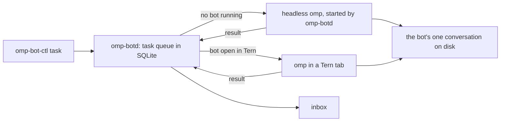

omp-bot turns an omp session in Tern into a named, animated bot you chat with, pet and run alongside other bots. Each bot keeps one conversation for good, and takes tasks in the background even when Tern is closed.

## Run

Needs Tern, omp, bun, jq and flock on `PATH` (`OMP_BIN` picks another omp; a bot runs on your omp config's default model unless `OMP_BOT_MODEL` names another).

- `bin/omp-botd` is the supervisor that queues tasks and runs bots. finix runs it as the `omp-botd` service.
- `bin/omp-bot-ctl task BOT TEXT [--key KEY] [--origin ORIGIN]` queues a task. `inbox` lists finished and failed tasks you haven't acknowledged, `ack ID` acknowledges one, `tasks` lists recent ones and `status` shows which bots are awake.
- `bin/omp-bot-ctl restart BOT [--now]` restarts a bot once it is idle: no task leased and no turn running. A bot in a Tern tab comes back in the same tab with the same conversation; a background bot is started again by `omp-botd`. `--now` stops the current turn instead of waiting, and its task is retried. The command returns at once, so a bot can restart itself with it, and does when you ask it to.
- In Tern, the palette's **Bots: Open all** opens a tab for every bot not yet open in the current session, each with an orb in the rail. **Bots: Open bot** opens or focuses one, or names a new one and adds it to the roster. **Bots: Remove bot** closes a bot's tab, fails its queued tasks, takes it off the roster and moves its conversation to `archive/`; `bin/omp-bot-remove NAME` does the same from a shell. Bot tabs share the omp chat look (below, under **Chat look**) and add the bot's header, orb and status.
- `bin/omp-bot NAME` opens the bot `NAME` in any terminal. `bin/omp-bot-demo` opens a separate Tern window with only the bots; `--stop` closes it.
- `OMP_BOT_NO_TOOLS=1` starts bots with `--no-tools`, so they can only talk. Use it, with a throwaway `OMP_BOT_STATE`, whenever you try prompts: a separate state folder keeps a bot's memory apart but not its access to this machine.
- Bots hide their tool activity by default (`display.hideToolActivity` in `omp/demo.yml`, the overlay every bot runs with), so a tab shows its replies, the orb and one status word. Ctrl+Shift+O, or `/settings`, shows the tool cards for the session.
- A bot that moves with omp's `/move DIR` (or `/cwd DIR` from finix's omp `cwd.ts` extension) gets `DIR` saved as its `cwd` in the roster, so it starts there from now on, and its conversation stays in its `bots/NAME/sessions`, where plain omp would move it to omp's own sessions folder. `omp/cwd.ts` does this, loaded into every bot run.
- Every bot loads the omp extensions named by `OMP_BOT_CWD_EXTENSION` and `OMP_BOT_SECRETS_EXTENSION`, when set, even without `"extensions": true`. finix points them at its omp `cwd.ts`, for `/cwd`, and `secrets/secrets.ts`, for one-off secrets: a bot asks with its `secret` tool, you enter the value hidden with `omp-secret NAME`, and the bot uses it as `$SECRET_NAME` in bash without the value reaching the model, its conversation or its memory. Each bot only sees its own secrets (see finix's `modules/dev/ai/omp/README.md`). `OMP_BOT_WORK_FOLD_EXTENSION` and `OMP_BOT_CHAT_LOOK_EXTENSION` load finix's `work-fold.ts` and `chat-look.ts` the same way, for the folded tool runs and the chat look's blocks (below, under **Chat look**).
- `~/.config/omp-bot/env`, when present, is read as shell before a bot starts; finix sets `OMP_BIN` there to omp outside omp-box, `OMP_BOT_CWD_EXTENSION`, `OMP_BOT_SECRETS_EXTENSION`, `OMP_BOT_WORK_FOLD_EXTENSION` and `OMP_BOT_CHAT_LOOK_EXTENSION` to those four extensions, and `OMP_BOT_OPTCHAT` to the OptChat directory (`extension.ts` and `service.ts`, from finix's `modules/dev/ai/omp/optchat`) that bot memory runs on.

The roster is `bots.json` in the state folder below, copied from this repo's `bots.json` the first time anything runs. Add a bot by adding a line to it: `name`, a one-line `role`, a `tint` (red, orange, yellow, green, teal, blue, purple or pink), the `cwd` it starts in, and optionally a `persona` with extra instructions. Bots start without your own omp extensions; `"extensions": true` on a bot loads the ones your omp config lists, on top of the bot's own. `"model"` picks a bot's model; without it the bot uses `OMP_BOT_MODEL`, else your omp config's default. A bot's own `bots/NAME/config.yml` in the state folder, when present, is layered over the bot overlay, for settings only that bot should have. `bots/NAME/config.until-DATE.yml`, DATE as `date -d` reads it (`2026-11-04T13:00`), is layered over that until DATE: a later launch skips it, and a bot still running at DATE restarts once idle. Every bot keeps OptChat memory (below); `"memory": "none"` gives a bot omp's own compaction instead.

## Watching Tern

The Tern plugin sends two things to the daemon as they happen: a command that exited non-zero, and an agent whose turn or program ended. Each carries its pane, the command line, the exit status and the directory. The daemon's gate matches each one against `policy.json` and appends the decision to `shadow.log`, one JSON line per event: the rule that matched, which bot it would go to, the mandate, and the brief that bot would receive. It queues nothing, so this stage only shows what the bot would have been woken for.

```json
{"rules": [
  {"name": "failed-command", "kind": "command_finished", "when": {"status": "nonzero", "cwd": "~/dev"}, "bot": "Dev", "mandate": "diagnose"},
  {"name": "agent-done", "kind": "agent_finished", "bot": "Dev", "mandate": "review"}
]}
```

Rules are tried in order and the first match wins; an event that matches none is logged with `"rule": null`. `when` is optional and holds `status` (`zero` or `nonzero`) and `cwd`, a prefix that `~` expands in. `omp-bot-ctl event JSON` feeds one event in by hand.

## How it works



- **One process per bot.** Every bot runs omp with `omp/core.ts`, which connects to `omp-botd` and holds `bots/NAME/lock`, so a bot never runs twice. Opening a bot in Tern while it works in the background waits for the current task, stops the background copy and opens the same conversation.
- **Opening a bot that is still closing.** The lock is held only by the launcher's `flock`, never by programs omp leaves behind, so it is free the moment omp exits. When it is taken, `bin/omp-bot` asks `omp-botd` who holds it: a background copy is claimed and waited for, a tab that is still exiting is waited for with a notice, and only a bot open and live somewhere else fails, at once, with exit 75.
- **Restart.** `omp-bot-ctl restart` makes the bot's omp exit, and a bot in a tab then exits with code 76. The Tern plugin sees a bot tab's program exit with 76 and starts the bot again in the same tab, keeping its place, name and colour.
- **Tabs come back.** The Tern plugin keeps, per session, which bot tabs are open and where, in its plugin data (`kv.json`). When a window starts it reopens the ones missing from the current session, and for its first 15 seconds replaces a bot tab that came back as an idle shell (a single pane at its prompt) with the bot; a tab running anything else is left alone. A bot tab you close is forgotten once it has been gone for 10 seconds, so a window shutting down with its tabs doesn't forget them.
- **Memory.** A bot's conversation lives in `bots/NAME/sessions` and every start continues it, but the model never gets the whole transcript. Each bot has its own OptChat store in `bots/NAME/optchat`: its messages and replies are logged there and summarised into a tree of one-line summaries, the way the shared OptChat memory of omp chats works. On every model call a bot sees, in order, its pinned rules, its memory view, and its latest turns raw, tool calls and results included, up to `OPTCHAT_RAW` bytes (128 KB). The raw turns start where the view ends; when they outgrow the budget they are cut back to half of it and a fresh view is taken, so the prompt cache holds between cuts. omp's compaction is off for these bots (`omp/memory.yml`). A bot's first start with memory logs its existing conversation into the store, so nothing earlier is lost.
- **Pinned rules.** `bots/NAME/rules.md` is given to the bot word for word and never summarised. Edit it by hand, or tell the bot a standing rule: its `pin_rule` tool appends it.
- **Recall.** `zoom`, `date` and `recent` read a bot's memory, down to any message word for word. Given another bot's name they read that bot's memory instead, read-only, and `memories` lists the bots that keep one.
- **Summarisers.** `omp-botd` runs `bin/omp-bot-memory NAME`, a headless omp with OptChat's `service.ts` on the bot's store, while the bot is awake or its memory has unsummarised messages, and stops it once the bot sleeps and its view is built. Each writes `logs/NAME.optchat.log`; summariser spend is in `bots/NAME/optchat/spend.jsonl`, and `OPTCHAT_DIR=… optchat-spend` totals it.
- **Delivery is at least once, not exactly once.** A task is retried, up to 3 attempts, when its bot crashes, the model request fails or `omp-botd` restarts mid-task. A crash after a bot acted but before it reported back repeats the task, so each task carries its ID and attempt number. A retry is told to check what the earlier attempt did, and bots tag anything they post outside the conversation with `omp-bot:ID`. A task stopped by hand in Tern fails without a retry. Queuing the same `--key` twice queues it once.
- **Bots asking bots.** Bots other than the chief of staff are told they can ask another bot with `omp-bot-ctl task`. A task queued with `--origin bot:NAME` answers that bot instead of your inbox: when it finishes or finally fails, its result is queued to `NAME` as a new task marked `reply:` with the answering bot's name, keyed so it arrives once. A reply never triggers another reply, so two bots can't loop.
- **Attention.** A bot that has nothing worth your attention replies exactly "Nothing to report.", and that result skips the inbox.
- **Prompt.** `omp/prompt.ts` adds each bot's identity to the end of omp's system prompt: its name, lane and persona as its voice, the roster, when to act, when to speak and how to ask for a decision, with live chat and background tasks told apart. A bot whose role is "Chief of staff" also triages: it does quick work itself, names the bot and the `omp-bot-ctl task` brief for the rest, and reads the inbox to tell you what waits on you. `omp/demo.yml` sets omp's personality to `none` so the persona sets the tone.
- **Removal.** Removing a bot stops its whole background process group mid-task and holds the bot's lock while it archives the conversation.
- **Sleep.** A background bot stops after 5 idle minutes (`OMP_BOT_IDLE_EXIT_MS`). A bot is never killed mid-task to sleep.
- **Stopping the daemon.** On SIGTERM or SIGINT `omp-botd` drains: it leases no new task and starts no bot, stops idle background bots, lets each busy one finish its task and then stops it, and exits once none is left, or after `OMP_BOT_DRAIN_MS` (120 s) by stopping them mid-task, whose tasks are retried. A second signal stops it at once. Bots in Tern tabs keep running and reconnect when it is back. The service manager must wait longer than the drain before it kills the daemon: finix's `omp-botd` service needs a `stop-timeout` above 120 s.
- **Look.** A bot tab opens with a header line (orb, name, role, a Stop button while it works); the orb and a one-line status sit under the latest reply. A bot is opaque: its tool work is hidden, so the transcript holds its replies and nothing else, and the status says "Working" without naming the tool, counting steps or timing the turn. Ctrl+Shift+O brings the tool cards back for the session, where finix's `work-fold.ts` folds each run into one row with its step count and time that opens on click. Each bot's eyes, rings, accessory, glow and tempo come from a hash of its name, so a new bot gets its own look without a roster field; its tint comes from the roster, or from the same hash when it has none. The orb glances around, blinks, perks up while you type, bounces when a reply lands, gets drowsy and then naps.
- **Chat look.** In a bot tab the reply sits unboxed on the background in 15/22 px sans, your message is a small frosted bubble on the right, frosted like the composer, and the column is 720 px wide. Thinking, turn stats and the composer's usage and context meter are hidden, and a reply shows only once it is written: while it streams the status says "Writing it up…". finix's `chat-look.ts`, loaded into every bot and every omp chat, wraps each message in an `omp.chat.msg` block and the composer area in `omp.chat.dock`, and tells the model its tool calls are hidden when tool activity is off. Advisor notes are marked `omp.chat.advice` and show as one dim line, "Advisor · …", while the model still gets them whole.
- **Looks.** The chat look, the frosted bubbles and the no-streaming look are UI Menu tweaks in finix, group "omp chat" ("Grok chat", "frosted bubbles", "no streaming"), so they apply to any omp chat and are turned on and off there. `tern/bot.css` only keeps the bot's header line at the same 720 px column.

State lives in `${OMP_BOT_STATE:-${XDG_STATE_HOME:-~/.local/state}/omp-bot}`: `bots.json`, `tasks.db`, `bots/NAME/` (`sessions/`, `optchat/`, `rules.md`), `logs/NAME.log` for background runs, `logs/NAME.optchat.log` for summarisers and `botd.sock`.

## Not built yet

- Triggers other than `omp-bot-ctl`: schedules and GitHub issues, with replies posted back where they came from.
- HAL9001 as chief of staff handing other bots tasks itself.
- The inbox inside Tern.
- Bots run omp directly on this machine, not in omp-box.

Initially drafted by Claude AI.
