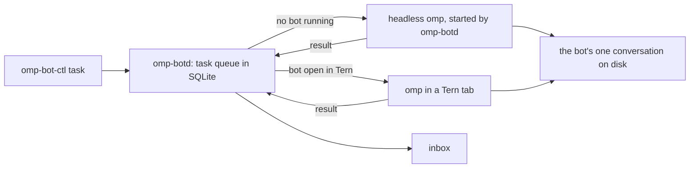

omp-bot turns an omp session in Tern into a named, animated bot you chat with, pet and run alongside other bots. Each bot keeps one conversation for good, and takes tasks in the background even when Tern is closed.

## Run

Needs Tern, omp, finix's `omp-until`, bun, jq and flock on `PATH`, and bash, ssh, tar and finix's `omp-box` for a boxed bot (`OMP_BIN` picks another omp; a bot runs on your omp config's default model unless `OMP_BOT_MODEL` names another).

- `bin/omp-botd` is the supervisor that queues tasks and runs bots. finix runs it as the `omp-botd` service.
- `bin/omp-bot-ctl task BOT TEXT [--key KEY] [--origin ORIGIN]` queues a task. `inbox` lists the decisions waiting on you and the finished and failed tasks you haven't acknowledged, `ack ID` acknowledges one, `approve|deny|handle ID [NOTE]` answers a decision, `tasks` lists recent ones, `board` prints them as the task board reads them, and `status` shows which bots are awake.
- `bin/omp-bot-ctl restart BOT [--now]` restarts a bot once it is idle: no task leased and no turn running. A bot in a Tern tab comes back in the same tab with the same conversation; a background bot is started again by `omp-botd`. `--now` stops the current turn instead of waiting, and its task is retried. The command returns at once, so a bot can restart itself with it, and does when you ask it to.
- A bot that can't start is down, not asleep. When `omp-botd`'s background start of a bot exits before the bot connects `OMP_BOT_MAX_STARTS` times in a row (3), or `bin/omp-bot-health` finds a boxed bot's box unreachable (every `OMP_BOT_HEALTH_MS`, a minute), `omp-botd` stops starting it and marks it down with the reason (a box that is still starting only holds its bots' background starts until it answers, and a start that finds the bot open elsewhere, its lock held, isn't a failure) (the last line the start printed, or why the box is down): `omp-bot-ctl status` shows `down since … : REASON`, a failed notice and every queued task of the bot go to the inbox with that reason, and a new task for it is refused with it. The Tern plugin polls `status --json`, toasts a bot going down and coming back, shows the reason in the status line and, when the bot's tint is its own, in its tab's subtitle. A bot comes back when it connects, when its box answers again (with a notice in the inbox), or with `omp-bot-ctl restart BOT`, which tries to start it again. A boxed bot's tab says why its box is down instead of starting.
- In Tern, the palette's **Bots: Open all** opens a tab for every bot not yet open in the current session, each with a mini Chao in the rail. **Bots: Open bot** opens or focuses one, or names a new one and adds it to the roster. **Bots: Remove bot** closes a bot's tab, fails its queued tasks, takes it off the roster and moves its conversation to `archive/`; `bin/omp-bot-remove NAME` does the same from a shell, and `bin/omp-bot-remove NAME --purge` also deletes the data of the folders it declared under `persist` (below, under **Persistence**). Bot tabs share the omp chat look (below, under **Chat look**) and add the bot's header, orb and status.
- `bin/ompd serve` runs the job daemon (below, under **Durability**), and a lock on `ompd.lock` keeps it to one. finix runs it as the `ompd` service, `bin/ompd serve --wait`, which waits for the lock instead of leaving when a copy already holds it, starts at boot, is started again whenever it exits, and gets a delegated cgroup for its jobs' memory limit; `OMPD_SERVICE=1`, set in finix's `~/.config/omp-bot/env`, makes bots wait up to a minute for the service to come back instead of starting a copy of their own. Without it, a bot starts ompd when it isn't running. finix also lists `omp/ompd.ts` in the host's omp config, so every omp session on the host, not only bots, runs its commands as ompd jobs, owned by `session:ID` where a bot's are `bot:NAME`; omp loads an extension path once however many times it is named, so a bot with `"extensions": true` that also gets it with `-e` runs one copy. finix lists it, and its other extensions, by links under `~/.omp/agent/ext` rather than by store path, and points `OMP_BOT_OMPD_EXTENSION`, which a bot loads in place of `omp/ompd.ts`, at the same link: a switch then changes no path in the omp config, so running sessions are not told to restart omp for "newly enabled extensions", and a bot names the extension by the same path as the config, so it still runs one copy. The box's omp config lists it too, so omp in the box runs its commands as jobs of an ompd in the box, the one boxed bots use. `bin/ompd jobs` lists jobs, `show ID` prints one with its log's path, `kill ID` stops one and `run [--owner O] [--timeout S] [--rerunnable] -- CMD` starts one by hand.
- In Tern, the palette's **Bots: Task board** opens the board of every decision waiting on you (below, under **Task board**); `bin/omp-bot-board` opens it in a separate Tern window, `--stop` closes it.
- `bin/omp-bot-simplefin` is Regal's read-only SimpleFIN client (Regal, the financier, is a boxed bot whose kept folder is `~/.local/state/regal`): `claim` sends a SimpleFIN Bridge setup token (`SIMPLEFIN_SETUP_TOKEN`) to its claim URL once, never twice whatever happened, stores the access URL it gets as the bot's secret `SIMPLEFIN_ACCESS_URL` and forgets the token; `fetch` reads `/accounts` with pending transactions into `~/.local/state/regal/simplefin` (`SIMPLEFIN_DIR`): `accounts.json` with the balances, `transactions.json` merged by account and transaction, and the raw answers. It serves the cache when the last fetch is under four hours old, refuses a 25th request in 24 hours (Bridge expects 24 a day) and windows over 90 days, and only speaks https with certificates checked; `status` shows the cache and the requests used. The budget is `~/.local/state/regal/budget.md`, plain Markdown Regal keeps with you.
- `bin/omp-bot NAME` opens the bot `NAME` in any terminal. `bin/omp-bot-demo` opens a separate Tern window with only the bots; `--stop` closes it.
- `OMP_BOT_NO_TOOLS=1` starts bots with `--no-tools`, so they can only talk. Use it, with a throwaway `OMP_BOT_STATE`, whenever you try prompts: a separate state folder keeps a bot's memory apart but not its access to this machine.
- Bots hide their tool activity by default (`display.hideToolActivity` in `omp/demo.yml`, the overlay every bot runs with), so a tab shows its replies, the Chao and one status word. Ctrl+Shift+O, or `/settings`, shows the tool cards for the session.
- A bot that moves with omp's `/move DIR` (or `/cwd DIR` from finix's omp `cwd.ts` extension) gets `DIR` saved as its `cwd` in the roster, so it starts there from now on, and its conversation stays in its `bots/NAME/sessions`, where plain omp would move it to omp's own sessions folder. `omp/cwd.ts` does this, loaded into every bot run.
- Every bot loads the omp extensions named by `OMP_BOT_CWD_EXTENSION` and `OMP_BOT_SECRETS_EXTENSION`, when set, even without `"extensions": true`. finix points them at its omp `cwd.ts`, for `/cwd`, and `secrets/secrets.ts`, for one-off secrets: a bot asks with its `secret` tool, you type the value into the masked box it opens in the bot's tab (or run `omp-secret NAME`), and the bot uses it as `$SECRET_NAME` in bash without the value reaching the model, its conversation or its memory. Each bot only sees its own secrets (see finix's `modules/dev/ai/omp/README.md`). `OMP_BOT_WORK_FOLD_EXTENSION` and `OMP_BOT_CHAT_LOOK_EXTENSION` load finix's `work-fold.ts` and `chat-look.ts` the same way, for the folded tool runs and the chat look's blocks (below, under **Chat look**).
- `~/.config/omp-bot/env`, when present, is read as shell before a bot starts; finix sets `OMP_BIN` there to omp outside omp-box, `OMP_BOT_CWD_EXTENSION`, `OMP_BOT_SECRETS_EXTENSION`, `OMP_BOT_WORK_FOLD_EXTENSION` and `OMP_BOT_CHAT_LOOK_EXTENSION` to those four extensions, `OMP_BOT_OMPD_EXTENSION` to its link to `omp/ompd.ts` (above), `OMP_BOT_OPTCHAT` to the OptChat directory (`extension.ts` and `service.ts`, from finix's `modules/dev/ai/omp/optchat`) that bot memory runs on, and `OMP_BOT_PERSIST` to its persistence hook (below, under **Persistence**). `~/.config/omp-bot/box.env` is read after it for a bot with `"box": true` (below, under **Boxed bots**).

The roster is `bots.json` in the state folder below, copied from this repo's `bots.json` the first time anything runs. Add a bot by adding a line to it: `name`, a one-line `role`, a `tint` (red, orange, yellow, green, teal, blue, purple or pink), the `cwd` it starts in, and optionally a `persona` with extra instructions and a `chao` look (below, under **Look**). Bots start without your own omp extensions; `"extensions": true` on a bot loads the ones your omp config lists, on top of the bot's own. `"model"` picks a bot's model; without it the bot uses `OMP_BOT_MODEL`, else your omp config's default. A bot's own `bots/NAME/config.yml` in the state folder, when present, is layered over the bot overlay, for settings only that bot should have. `bots/NAME/config.until-DATE.yml`, DATE as `date -d` reads it (`2026-11-04T13:00`), is layered over that until DATE by finix's `omp-until`: a later launch skips it, and a bot still running at DATE restarts once idle. Every bot keeps OptChat memory (below); `"memory": "none"` gives a bot omp's own compaction instead. `"persist"` lists folders of the bot's that survive a reboot (below, under **Persistence**), and `"box": true` runs the bot inside omp-box (below, under **Boxed bots**).

## Task board

`task-board/` is a Tern plugin, linked into Tern by finix like `tern/`: the palette's **Bots: Task board** opens one board of the bots' tasks in `omp-botd`'s queue. It reads `omp-bot-ctl board` when it opens and every three seconds while it is open, and answers with `omp-bot-ctl approve|deny|handle`, the same `answer` the bot tabs' cards send, so a decision answered in either place leaves the other.

- **One list of decisions**, most important first, and only tasks waiting on your decision: those a bot parked with `ask_decision`. A finished report is never a decision, even one that ends in a question, and a failure goes to the history. CU-Bot's asks start above the rest; ⇧↑/⇧↓ or the ▲▼ buttons bump one through the list, and the board keeps your order. The top three show in full, the rest is one `+N more` line (`m` opens it).
- **Answering.** `a`, `d`, `h` or the buttons on the selected ask: Approve, Deny (with an optional one-line reason, which reaches the bot as the note) and Handle (the bot decides). The row flies off, its Chao reacts, a stamp says what happened and quick runs count a streak; an empty list ends on inbox zero. An answer the queue refuses, because it was answered elsewhere meanwhile, puts the row back with a toast.
- **At work**, under the list: each bot with work, its running task (or *in chat*) and every subagent it runs through omp's task tool, nested ones under their parent, each with its name, its goal and how long it has run. A bot's `omp/core.ts` hears omp's `task:subagent:lifecycle` and `progress` events in every session of the bot, subagents' own included, and sends each start, goal and end to `omp-botd`, which keeps them in `tasks.db`'s `subagents` table (and, when the bot reconnects, the ones still running). They are rows to read, never decisions; a finished one moves to the history, done, failed, or stopped when its bot went away.
- **The quiet line** under the list: the work in progress as a count, finished tasks and subagents (`v` shows the newest eight and how you answered them; `Nothing to report.` results are left out), and the **Later** shelf (`l`), asks untouched for three days, kept out of the list until you open it.
- **Look.** Ozette's structure, coloured by the theme alone: the same paper cards, hairlines and offset shadows in light and dark, only the colours change, and the liveliness is in the motion. No animation runs endlessly, and the board redraws only when a read changed something (or once a minute, for the ages), so an open board leaves Tern idle.

The Chao are omp-bot's rail sprites (`tern/window.luau`), drawn as SVG in `task-board/chao.luau`; a plugin can't require a file outside its folder, so keep the two in step. `bin/omp-bot-board` opens the board in a separate Tern window with its own config, daemon and Tern state under `$XDG_STATE_HOME/omp-bot-board` (copies of your Ozette plugin and themes when you have them), on the queue `OMP_BOT_STATE` names; `--headless` serves it offscreen and prints the control socket for `tern ctl … shot NAME`, and `--stop` closes it.

## Persistence

A bot lists the folders that must survive a reboot in its own roster entry, `"persist": ["~/.local/state/baobot"]`, each absolute or under `~` and inside your home. That entry is the one place they are set. On a machine whose home is reset at every boot, the `OMP_BOT_PERSIST` hook keeps them: `bin/omp-bot` runs `$OMP_BOT_PERSIST mount PATH` for each before the bot starts, which the first time copies the folder into the persistent store and mounts it back over itself, and prints the paths it has just mounted. finix sets the hook to its `omp-bot-persist`, and at boot reads every bot's `persist` from the persisted roster and mounts those folders with the rest of its persistence allowlist, before any of your services start. Without a hook, `persist` only records the folders, for a purge.

- Stopping, crashing, killing or restarting a bot never touches its persisted data.
- Removing a bot (**Bots: Remove bot** or `omp-bot-remove NAME`) takes it off the roster, so its folders are no longer mounted from the next boot, but their data stays in the persistent store, and the bot's roster entry is kept in `archive/NAME-DATE/roster.json`. A bot missing from the roster is never taken to mean its data should go.
- Only `omp-bot-remove NAME --purge` deletes it. It removes the bot first if it is still on the roster, then, for every folder the bot's archived entries declare, unmounts it and deletes both the persisted copy and the folder (`$OMP_BOT_PERSIST purge PATH`, or `rm -rf PATH` without a hook). A folder another bot on the roster declares is kept, and so is the archived conversation.

## Boxed bots

`"box": true` runs a bot's omp inside omp-box, finix's microVM, instead of on this machine; its tab, `omp-botd`, the queue and its memory summariser stay here. `bin/omp-bot` reads `~/.config/omp-bot/box.env` after `env` for such a bot and runs `bin/omp-bot-box` in omp's place, which:

- shares the bot's folder, `bots/NAME`, and each of its `persist` folders into the box at the same paths (`omp-box add PATH --name omp-bot.NAME`, then `omp-bot.NAME.1` and on), sharing again a folder the persist hook has just mounted so the box sees the persisted one;
- hands the roster to the box's state folder, which has the same path as here with only `bots/NAME` shared, and copies omp-bot and the extensions the bot loads to `~/.cache/omp-bot/box/store` in the box when the box's own store lacks them, naming one by the link in `OMP_BOT_BOX_EXT` that points at its copy when there is one, so the bot and the box's own omp config name it by one path and omp loads it once, naming an extension by its store path when it is given by a link into the store, so a pin bump needs no new box;
- runs the box's `omp` over ssh, through the ssh config `OMP_BOT_BOX_SSH_CONFIG` names (any host name reaches the box), with `botd.sock` forwarded into the box by `ssh -R`, the bot's environment (`OMP_BOT_*`, `OMPD_*`, `OPTCHAT_*`, `PI_*`, `OMP_UNTIL`, `TERM`, `TERM_PROGRAM`, `COLORTERM` and the locale) and `OMP_BOT_PID`, the pid of that ssh here, which `omp-botd` checks instead of the box's. A tab gets a pty, so Tern's native blocks come through and a boxed bot looks like any other; a background bot's RPC runs over ssh's stdin and stdout.

finix's `box.env` sets `OMP_BOT_BOX_SSH_CONFIG`, `OMP_BOT_BOX_STATUS` (the box's `status.json`: `starting`, `up`, `crashed` or `failed` with a reason, which `bin/omp-bot-health` reports when the box doesn't answer), `OMP_BOT_BOX_EXT` (`/mnt/seed/current/ext` in the box's seed share: a link per extension the box's own omp config loads, omp-bot and the secrets extension among them, each to a copy of its store path, which finix updates on a switch without restarting the box), `OMP_BOT_BOX_PATH` (`/mnt/seed/current/bin`, put on the bot's `PATH` in the box: `age` and `omp-secret`, which the secrets extension runs) and unsets `OMP_BOT_EXTENSION` (the box reaches models through omp-box's gateway proxy, not Crest) and `OMPD_SERVICE` (a boxed bot starts ompd in the box itself). With `"extensions": true` a boxed bot loads the box's omp config's extensions.

A boxed bot asks for secrets as any bot does, its masked box opening in its tab, but keeps them in its own folder, `bots/NAME/secrets` (`OMP_SECRETS_DIR`, which `bin/omp-bot-box` sets), encrypted with a key of their own there, so they are decrypted only inside the box and never join the host's secret store that host omp sessions read. From a shell, `OMP_SECRETS_DIR=$OMP_BOT_STATE/bots/NAME/secrets omp-secret NAME --bot NAME` enters one.

The copied files live in the box and are gone after the box restarts; the box's ompd jobs and logs live on a share of finix's (`ompd-jobs` in omp-box's state), so a job cut off by a box restart is reported, not forgotten. A bot in a tab whose box goes away (a box restart cuts its ssh, or its box is down when it starts) waits in the tab until the box answers again and carries on there, restoring its session; five cut-offs in a row while the box answers, each within a minute of starting, end the tab instead. A boxed bot's conversation, memory and `persist` folders are shares and stay. It reads only its own memory, since only its folder is shared, and its `/move` changes only the box's copy of the roster.

finix's omp-box keeps headless Chromium running for boxed bots that browse (its `browsers` setting: one service per browser, the profile on a share, DevTools on `127.0.0.1:PORT` inside the box); the bot attaches to it with `browser.cdpUrl` in its `bots/NAME/config.yml`.

## Watching Tern

The Tern plugin sends two things to the daemon as they happen: a command that exited non-zero, and an agent whose turn or program ended. Each carries its pane, the command line, the exit status and the directory. The daemon's gate matches each one against `policy.json` and appends the decision to `shadow.log`, one JSON line per event: the rule that matched, which bot it would go to, the mandate, and the brief that bot would receive. It queues nothing, so this stage only shows what the bot would have been woken for.

```json
{"rules": [
  {"name": "failed-command", "kind": "command_finished", "when": {"status": "nonzero", "cwd": "~/dev"}, "bot": "Lloyd", "mandate": "diagnose"},
  {"name": "agent-done", "kind": "agent_finished", "bot": "Lloyd", "mandate": "review"}
]}
```

Rules are tried in order and the first match wins; an event that matches none is logged with `"rule": null`. `when` is optional and holds `status` (`zero` or `nonzero`) and `cwd`, a prefix that `~` expands in. `omp-bot-ctl event JSON` feeds one event in by hand.

## How it works



- **One process per bot.** Every bot runs omp with `omp/core.ts`, which connects to `omp-botd` and holds `bots/NAME/lock`, so a bot never runs twice. Opening a bot in Tern while it works in the background waits for the current task, stops the background copy and opens the same conversation.
- **Opening a bot that is still closing.** The lock is held only by the launcher's `flock`, never by programs omp leaves behind, so it is free the moment omp exits. When it is taken, `bin/omp-bot` asks `omp-botd` who holds it: a background copy is claimed and waited for, a tab that is still exiting is waited for with a notice, and only a bot open and live somewhere else fails, at once, with exit 75.
- **Restart.** `omp-bot-ctl restart` makes the bot's omp exit, and a bot in a tab then exits with code 76. finix's Agent Tabs Tern plugin sees a registered tab's program exit with 76 and starts it again in the same tab, keeping its place, name and colour.
- **Tabs come back.** The Tern plugin registers every bot in the roster with Agent Tabs, under the `agent-tabs` key of its plugin data (`kv.json`): bot name → the command that opens it and its tint. Agent Tabs keeps, per session, which registered tabs are open and where. When a window starts it reopens the ones missing from the current session, and for its first 15 seconds replaces a registered tab that came back as an idle shell (a single pane at its prompt) with its command; a tab running anything else is left alone. A tab you close is forgotten once it has been gone for 10 seconds, so a window shutting down with its tabs doesn't forget them.
- **Memory.** A bot's conversation lives in `bots/NAME/sessions` and every start continues it, but the model never gets the whole transcript. Each bot has its own OptChat store in `bots/NAME/optchat`: its messages and replies are logged there and summarised into a tree of one-line summaries, the way the shared OptChat memory of omp chats works. On every model call a bot sees, in order, its pinned rules, its memory view, and its latest turns raw, tool calls and results included, up to `OPTCHAT_RAW` bytes (128 KB). The raw turns start where the view ends; when they outgrow the budget they are cut back to half of it and a fresh view is taken, so the prompt cache holds between cuts. omp's compaction is off for these bots (`omp/memory.yml`). A bot's first start with memory logs its existing conversation into the store, so nothing earlier is lost. The tab never loses any of it either: like Grok Bot, it shows the whole conversation, every message and event since the bot's first start, across restarts and an omp compaction alike (`display.collapseCompacted: false` in `omp/demo.yml`; a compaction from before memory, or a manual `/compact`, is a divider in place), while the model still gets only its memory view.
- **Pinned rules.** `bots/NAME/rules.md` is given to the bot word for word and never summarised. Edit it by hand, or tell the bot a standing rule: its `pin_rule` tool appends it.
- **Recall.** `zoom`, `date` and `recent` read a bot's memory, down to any message word for word. Given another bot's name they read that bot's memory instead, read-only, and `memories` lists the bots that keep one.
- **Summarisers.** `omp-botd` runs `bin/omp-bot-memory NAME`, a headless omp with OptChat's `service.ts` on the bot's store, while the bot is awake or its memory has unsummarised messages, and stops it once the bot sleeps and its view is built. Each writes `logs/NAME.optchat.log`; summariser spend is in `bots/NAME/optchat/spend.jsonl`, and `OPTCHAT_DIR=… optchat-spend` totals it.
- **Delivery is at least once, not exactly once.** A task is retried, up to 3 attempts, when its bot crashes without coming back to it, the model request fails, or its attempt stops checking in (below, under **Durability**). A crash after a bot acted but before it reported back repeats the task, so each task carries its ID and attempt number. A retry is told to check what the earlier attempt did, and bots tag anything they post outside the conversation with `omp-bot:ID`. A task stopped by hand in Tern fails without a retry. Queuing the same `--key` twice queues it once.
- **Bots asking bots.** Bots other than the chief of staff are told they can ask another bot with `omp-bot-ctl task`. A task queued with `--origin bot:NAME` answers that bot instead of your inbox: when it finishes or finally fails, its result is queued to `NAME` as a new task marked `reply:` with the answering bot's name, keyed so it arrives once. A reply never triggers another reply, so two bots can't loop.
- **Attention.** A bot that has nothing worth your attention replies exactly "Nothing to report.", and that result skips the inbox.
- **Prompt.** `omp/prompt.ts` adds each bot's identity to the end of omp's system prompt: its name, lane and persona as its voice, the roster, when to act, how to see an ask through and keep its loops closed, when to speak and how to ask for a decision, with live chat and background tasks told apart. A bot whose role is "Chief of staff" also triages: it does quick work itself, names the bot and the `omp-bot-ctl task` brief for the rest, and reads the inbox to tell you what waits on you. `omp/demo.yml` sets omp's personality to `none` so the persona sets the tone.
- **Removal.** Removing a bot stops its whole background process group mid-task and holds the bot's lock while it archives the conversation.
- **Sleep.** A background bot stops after 5 idle minutes (`OMP_BOT_IDLE_EXIT_MS`). A bot is never killed mid-task to sleep.
- **Stopping the daemon.** On SIGTERM or SIGINT `omp-botd` drains: it leases no new task and starts no bot, stops idle background bots, lets each busy one finish its task and then stops it, and exits once none is left, or after `OMP_BOT_DRAIN_MS` (120 s) by stopping them mid-task, whose tasks are retried. A second signal stops it at once. Bots in Tern tabs keep running and reconnect when it is back. The service manager must wait longer than the drain before it kills the daemon: finix's `omp-botd` service needs a `stop-timeout` above 120 s.
- **Look.** A bot tab opens with a header line (the bot's Chao, name, role, a Stop button while it works); the Chao and a one-line status sit under the latest reply. A reply is never streamed: it appears whole once finished while the status says the bot is writing; `omp-bot.ts` wraps each reply in an `omp.bot.reply` block holding only its written text, images and errors. A bot is opaque, as Grok Bot is: its tool work, its thinking and advisor notes stay out of the transcript (the model still gets the advice), so the transcript holds your messages and its replies, and the status line, the Chao and one shimmering word with the turn's time, says "Thinking…" or "Working" without naming the tool or counting steps. Ctrl+Shift+O brings the tool cards back for the session, where finix's `work-fold.ts` folds each run into one row with its step count and time that opens on click. Each bot is a Chao, a small pixel-art creature in the style of Sonic Adventure 2's, drawn by `omp/chao.ts`: its type (neutral; hero, white with a halo; dark, navy with a red spiky ball), eyes and tempo come from a hash of its name, its body colour from its tint, which comes from the roster or the same hash. `"chao"` on a bot in the roster overrides the hash, as a type (`"chao": "dark"`) or `{"type": "hero", "eyes": "round"}` (eyes `oval`, `round` or `dot`). It blinks, and the ball over its head shows how it is: it floats while the bot idles, turns to `?` while it thinks and a spinning swirl while it works or writes, becomes `!` with a hop when a reply lands and stays `!` while the bot waits on you, a heart when you pet it, droops with sad eyes when something fails, and gives way to Zs when the bot naps, eyes shut and slumped. The rail shows a mini Chao of each bot.
- **Events and decisions.** IRC messages, helper messages and background-task deliveries are one muted, centred event row with the action, a small Chao and the bot's name, as Grok Bot shows them: `Message from`, `Messaged`, or `N messages with` for a run of messages with one peer (its outgoing `agent://` writes count, though their tool cards stay hidden). Clicking a row with a peer opens the exchange view, a page of its own laid out like Grok Bot's bot-to-bot transcript: a pill naming both bots, a centred timestamp, each run of messages under its sender's name in its tint with its Chao at the bottom left, both bots on the left, and one Close Chat button where the composer was (Esc, Enter or q close it too). A task's own delivery without a peer still opens in place. An ompd job's result is the same row with ✓ exit 0, ✗ exit N or ⏱ timed out or killed, its time and its command; clicking it shows the command, the output tail and the log's path as a run box. Rows stay where they landed, as Grok Bot keeps its messages: omp shows a live IRC card for only 10 seconds and at most four at a time, then removes it, and the message itself comes back only when the transcript is next rebuilt from the session, so `omp-bot.ts` keeps IRC cards in bot tabs. A bot messaging a peer says `Messaging NAME` in the ordinary status row. In live chat the prompt sends genuine user decisions with two or three options and a recommendation through omp's native `ask` dialog, never through a parallel card or a background task.
- **Chat look.** A bot tab is laid out like Grok Bot's chat: the bot's replies are tinted bubbles on the left and your messages bubbles on the right, each at most 560 px wide, padded 7 px by 12 px, 12 px apart between turns and 4 px between replies of one turn, with a centred timestamp (`Today 9:41 AM`) at the top and wherever 15 minutes or a day pass between messages, as Grok Bot spaces its chat (when omp rebuilds the transcript, as it does whenever an extension's message such as an ompd job result reaches an idle bot, the times are read from the session again rather than reset to now); pasted images sit above your bubble rather than inside it; turn stats and the composer's context meter, usage and extras are hidden. `omp-bot.ts` marks your messages `omp.bot.you` and the composer `omp.bot.dock` so `bot.css` styles bot tabs only, with corners and colours from the theme (square and pink under Ozette). finix's `chat-look.ts`, loaded into every bot and every omp chat, wraps each message in an `omp.chat.msg` block and the composer area in `omp.chat.dock`, and tells the model its tool calls are hidden when tool activity is off.
- **Looks.** The chat look, the frosted bubbles and the no-streaming look are UI Menu tweaks in finix, group "omp chat" ("Grok chat", "frosted bubbles", "no streaming"), so they apply to any omp chat and are turned on and off there.

State lives in `${OMP_BOT_STATE:-${XDG_STATE_HOME:-~/.local/state}/omp-bot}`: `bots.json`, `tasks.db`, `bots/NAME/` (`sessions/`, `optchat/`, `rules.md`), `logs/NAME.log` for background runs, `logs/NAME.optchat.log` for summarisers, `botd.sock`, and ompd's `ompd.sock`, `ompd.lock`, `logs/ompd.log` and `jobs/ID/` (`job.json`, the `command`, the bot's environment in `env.json`, `log`, and the `pid` and `exit` status the job writes itself).

## Durability (ompd)

After a reboot, a crash or a restart, bots and their work carry on with no one re-tasking them. The model is Pi Durable: every step is journaled, a tool call is recorded before it runs, and a command cut off midway is never blindly run again.

- **Turns resume.** A bot in a tab starts with omp's `--restore` on its newest session, so a turn cut off by a kill goes on where it stopped. omp records each tool call before running it; on restore it marks the cut-off calls outcome unknown and then replays them, and `omp/ompd.ts` blocks such a replay, so the bot is told the outcome is unknown and checks before running anything again. `omp/core.ts` keeps the task it works on in `bots/NAME/task.json`, and `omp-botd` keeps a tab's task leased for a minute after the tab drops, so the restored turn finishes that task instead of it being handed out again. A background bot runs omp in RPC mode, which refuses `--restore`, so `omp/core.ts` does the same thing itself: on start it hands the bot's session to omp's own restore (`restoreSession` from `@oh-my-pi/pi-coding-agent/task/restore`), which goes on with the interrupted turn and its subagents, the replayed calls blocked or handed back their ompd jobs as in a tab. When a background bot's connection drops mid-task, `omp-botd` keeps the task and starts the bot again at once instead of retrying it, and a restarted `omp-botd` (after a crash or a reboot) starts every background bot whose `bots/NAME/task.json` names a task it still holds, so the same attempt finishes with no one restarting anything. A task whose bot keeps dying is retried as a new attempt after three resumes.
- **ompd owns long jobs.** `omp/ompd.ts` replaces the bash tool, for a bot and its subagents: each command becomes a job of `bin/ompd`, a process outside the bot with a handle and a log on disk (`jobs/ID/`). The tool waits for it as bash would; one still running after `OMPD_FOREGROUND_S` seconds (300), started with `async`, or left when the turn is stopped, keeps running, and its result arrives in the conversation as a message when it ends, even if the bot restarted in between: the outcome, the time, the command on one line, the output's last 50 lines (6 KB at most) and the log's path for the rest. A tool call cut off by a kill is replayed by `--restore` with the same call ID, and ompd hands back the job that call already started instead of starting another. Jobs outlive the bot and `bin/ompd` itself, which reattaches to them when it starts again. A host crash kills them: ompd then reruns only jobs marked rerunnable (Lean builds always are) and reports the rest as outcome unknown. Lean builds (`lake`, `lean`) wait for one of `OMPD_LEAN_SLOTS` slots (default: half the machine's memory over the cap), and each job runs in its own cgroup capped at `OMPD_JOB_MEMORY` (12G) with no swap: the kernel kills all of its processes together the moment they reach the cap, ompd reports it killed for memory, and it is never rerun, rerunnable or not. The cgroups go under `OMPD_CGROUP`, else the parent of the cgroup ompd runs in, which must be its user's to write: finix's `ompd` service gets one delegated by finit. An ompd without such a cgroup runs its jobs with no memory limit and says so in `logs/ompd.log`. `pty` commands run in the bot as before and don't outlive it.
- **Journal rules,** as in Crest: a job is recorded before it starts; a shell command cut off by a crash is never rerun but reported outcome unknown; every state file is written to a temporary file and renamed, so a kill leaves the old or the new one; a record carries the version of the code that wrote it, and other code never replays it.
- **One task list.** `omp-botd`'s queue is the one list of work, each task queued, running, waiting, done or failed. A task waits on your decision when its bot asked with its `ask_decision` tool; it shows in `omp-bot-ctl inbox` with the question, and you answer with one of three actions, `omp-bot-ctl approve|deny|handle ID [NOTE]` (handle leaves the call to the bot), or in the bot's Tern tab: `omp-botd` sends a tab its bot's waiting decisions, and once the bot is idle each comes up as omp's native ask card, styled like the bot's chat, with Approve, Deny and Handle (Other… answers in your own words and leaves the call to the bot with them as the note). A card answered elsewhere closes; one you hide stays hidden until the tab restarts or `/decisions` brings it back; the task is queued again, as a fresh first attempt, and the bot gets your answer with it. A task also waits, still held by its bot, when its turn ended with ompd jobs it started still running; the turn their results start finishes it.
- **Heartbeats.** Each attempt at a task gets its own token. The bot checks in with it every `OMP_BOT_HEARTBEAT_MS` (30 s) while it holds the task; an attempt that misses three check-ins is expired and the task retried, and a check-in or report carrying an expired attempt's token is ignored. A restarted `omp-botd` gives the tasks bots held three check-ins to claim them back before retrying them.

## Not built yet

- Triggers other than `omp-bot-ctl`: schedules and GitHub issues, with replies posted back where they came from.
- HAL9001 as chief of staff handing other bots tasks itself.
- The inbox inside Tern.
- Lean builds started outside ompd don't take its slots.

Initially drafted by Claude AI.
