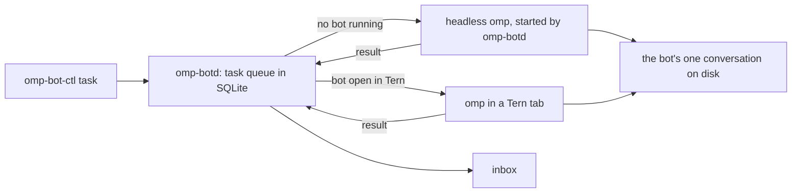

omp-bot turns an omp session in Tern into a named, animated bot you chat with, pet and run alongside other bots. Each bot keeps one conversation for good, and takes tasks in the background even when Tern is closed.

## Run

Needs Tern, omp, bun, jq and flock on `PATH` (`OMP_BIN` picks another omp, `OMP_BOT_MODEL` another model; default `smol`).

- `bin/omp-botd` is the supervisor that queues tasks and runs bots. finix runs it as the `omp-botd` service.
- `bin/omp-bot-ctl task BOT TEXT [--key KEY] [--origin ORIGIN]` queues a task. `inbox` lists finished and failed tasks you haven't acknowledged, `ack ID` acknowledges one, `tasks` lists recent ones and `status` shows which bots are awake.
- `bin/omp-bot NAME` opens the bot `NAME` from `bots.json` in any terminal. `bin/omp-bot-demo` opens a Tern window with one tab per bot, a flat chat and a roster rail; `--stop` closes it.
- In Tern, the palette's **Bots: Open all** opens every bot not yet open; **Bots: New bot** opens one, or names a new one and adds it to `bots.json`.

Add a bot by adding a line to `bots.json`: `name`, a one-line `role`, a `tint` (red, orange, yellow, green, teal, blue, purple or pink), the `cwd` it starts in, and optionally a `persona` with extra instructions.

## How it works

- **One process per bot.** Every bot runs omp with `omp/core.ts`, which connects to `omp-botd` and holds `bots/NAME/lock`, so a bot never runs twice. Opening a bot in Tern while it works in the background waits for the current task, stops the background copy and opens the same conversation.
- **Memory.** A bot's conversation lives in `bots/NAME/sessions` and every start continues it. omp's normal compaction keeps it within the context window.
- **Delivery is at least once, not exactly once.** A task is retried, up to 3 attempts, when its bot crashes, the model request fails or `omp-botd` restarts mid-task. A crash after a bot acted but before it reported back repeats the task, so each task carries its ID and attempt number. A retry is told to check what the earlier attempt did, and bots tag anything they post outside the conversation with `omp-bot:ID`. A task stopped by hand in Tern fails without a retry. Queuing the same `--key` twice queues it once.
- **Attention.** A bot that has nothing worth your attention replies exactly "Nothing to report.", and that result skips the inbox.
- **Sleep.** A background bot stops after 5 idle minutes (`OMP_BOT_IDLE_EXIT_MS`). A bot is never killed mid-task to sleep.

State lives in `${OMP_BOT_STATE:-${XDG_STATE_HOME:-~/.local/state}/omp-bot}`: `tasks.db`, `bots/NAME/`, `logs/NAME.log` for background runs and `botd.sock`.

## Not built yet

- Per-bot optchat memory in place of omp's compaction.
- Triggers other than `omp-bot-ctl`: schedules and GitHub issues, with replies posted back where they came from.
- HAL9001 as chief of staff: reading other bots' memory and handing them tasks.
- The inbox inside Tern.
- Bots run omp directly on this machine, not in omp-box.

Initially drafted by Claude AI.
